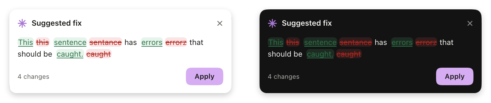
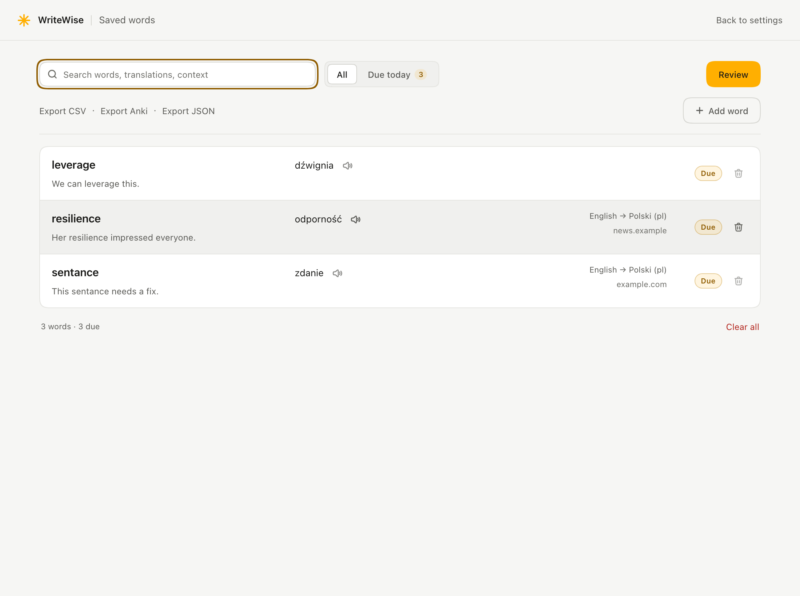
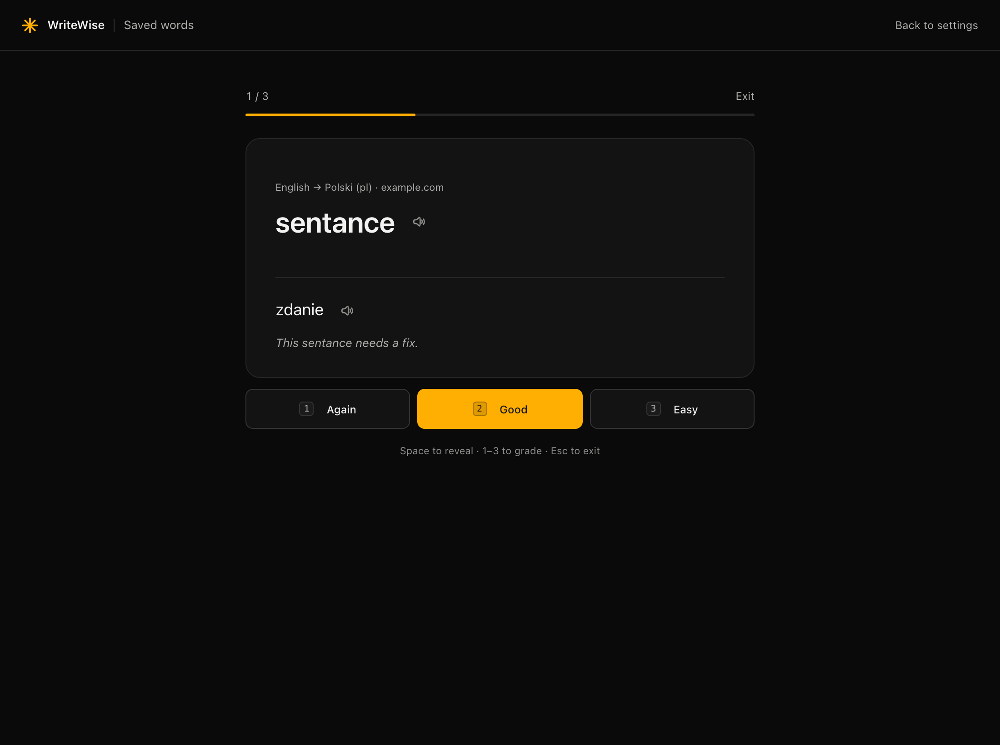

# WriteWise

**Improve your writing without leaving the text field.** WriteWise checks
spelling, grammar, clarity and tone after you pause. It highlights each change
before you apply it. Select text to translate it, then save useful words to
review later.

MV3 · no build step · DeepSeek or OpenAI · MIT

---

## See it in action

### Improve a sentence

WriteWise waits until you pause, then shows the suggested edits in the page.
You can inspect the diff and apply the result with one click, or dismiss it and
keep writing. The in-page card, settings and saved-word page support light and
dark themes.



### Translate a selection

Select a word or sentence to see the translation beside your work. Copy it,
replace selected text in an editable field, or save a word for later.


### Keep and review useful words

Saved words keep their translation and the sentence where you found them.
Search the list, export it, or review words due today.





## What it does

- **Corrects as you type.** Pause for a moment in any editable field and a card
  appears under it with an inline diff: spelling, grammar, clarity and tone,
  depending on what you allow.
- **Translates what you select.** Double-click a word or select a sentence —
  English, Polish, Ukrainian or Russian.
- **Explains nothing you didn't ask.** No sidebar, no dashboard, no "AI magic".
  One card, the changes, two ways to dismiss it.
- **Keeps a vocabulary.** Words you save are stored locally with the sentence
  you found them in, then reviewed on a Leitner schedule.
- **Says words out loud.** The system voice by default; an optional neural
  voice through your OpenAI key when the OS voice isn't good enough.

## Install

WriteWise is not on the Chrome Web Store. It loads as an unpacked extension:

1. Download the ZIP from the [latest published release](../../releases/latest)
   and unzip it.
2. Open `chrome://extensions` and turn on **Developer mode**.
3. **Load unpacked** → choose the unzipped folder.
4. Pin the ✳ icon to the toolbar.

No build step, no `npm install`, no bundler. Editing a file and pressing
**Reload** on `chrome://extensions` is the whole development loop.

Requires Chrome 116+.

## Setup

1. Click the ✳ icon.
2. Pick **DeepSeek** or **OpenAI**.
3. Paste a key and press **Test** — you get a green dot, and the model list is
   replaced by the models that key can actually use.
4. That's it. Keys are stored in `chrome.storage.local` on this device only.

Get a key: [platform.deepseek.com](https://platform.deepseek.com/api_keys) ·
[platform.openai.com](https://platform.openai.com/api-keys)

## Using it

| Gesture | Result |
|---|---|
| Type and pause | Correction card with diff · **Apply** or dismiss |
| Select text (any length) | Translation card |
| `Alt+Shift+W` | Check the focused field now |
| Right-click → *Fix selection* | Check just that fragment |
| Right-click → *Translate selection* | Translate the selection on demand |
| `Enter` (card focused) | Apply / copy |
| `Esc` or click outside | Dismiss |

Applying writes the correction back into the field: textareas and inputs get a
native value write plus an `input` event; `contenteditable` gets
`execCommand('insertText')`, so the page's own undo stack still works. **Undo**
on the card restores the original.

## Translation

- Target languages: **English, Polski, Українська, Русский**, chosen in the
  popup. The language pair is shown in the card footer.
- The card speaks the original, in the original's language. The translation is
  read, never spoken: it is there to be copied or written into the field.
- **Copy** takes the translation; **Replace** writes it into the field when the
  text came from something you were editing.
- Selections up to 2 400 characters are accepted; beyond that the card says so
  instead of silently doing nothing.

## Saved words

A one-word translation can be **saved** — word, translation, the sentence you
met it in, and the site. Saving makes no API call.

The vocabulary page (popup footer → *N saved words*) has search, *All* / *Due
today* filters, expandable rows with review history, **Add word** for words met
away from the browser, and **Export CSV / Anki / JSON**. **Review** is a
spaced-repetition session: `Space` reveals, `1`/`2`/`3` grade, `Esc` leaves;
intervals run 1 → 2 → 4 → 8 → 16 days. The vault holds up to 2 000 words.

## Pronunciation

The OS speech engine is used by default — free, offline, no key, no request. Its
quality is the quality of the voices installed on your machine, which for some
languages is poor.

**Advanced → Pronunciation → Neural voice** switches to a neural voice fetched
by the service worker through your OpenAI key and played with Web Audio. Six
voices, about 1¢ a minute, cached per word so a repeat click is free. Off by
default: it is the one feature that sends text to a second place.

Where each engine runs is decided per language, not by the toggle alone. The
neural voices are English-trained, so a language that this computer already
speaks natively (Polish, Ukrainian, Russian on a Mac with those voices) is read
by the native voice — correct accent beats better timbre. The neural voice reads
English, and any language the system has no voice for, where it is given the
language in its instructions so it does not answer in English phonetics.

Either engine fails soft — no key, no network or an unplayable clip falls back to
the other one.

One case is not a fallback but a refusal: with the neural voice off and no
system voice for the language being read, the card does not borrow the English
voice — it says so and offers **Use neural voice**. Settings → Pronunciation
reports what this computer can pronounce for the chosen language.

## Models and cost

Models are not hard-coded in practice: with a key present, the popup asks the
provider for `/models`, keeps chat models, and picks a sensible default
(`deepseek-chat`, `gpt-4o-mini`). A saved model the key cannot use is replaced
automatically.

A 500-word check is roughly 600 input + 700 output tokens — fractions of a cent
on the fast models. The popup shows fixes today and an estimated spend; nothing
is billed by WriteWise itself.

## Privacy

- **No WriteWise server.** Text goes only to the provider you selected.
- **Keys stay local** (`chrome.storage.local`, deliberately not `storage.sync`).
- **No telemetry, no analytics, no accounts.**
- Password, payment (`autocomplete=cc-*`) and one-time-code fields are never
  read.
- Translation sends only the selected fragment, and only when you ask for it.
- Saved words never leave the device; the exports are the only way out, and you
  run them yourself.
- Permissions requested: `storage`, `contextMenus`, and host access to
  `api.deepseek.com` and `api.openai.com` only.

## Limits

- Canvas editors (Google Docs, Figma) expose no editable DOM — out of scope.
- Fields inside iframes are not watched.
- Applying to `contenteditable` replaces its content with plain text; formatting
  inside it is not preserved.
- Fields above the word limit are skipped rather than truncated.
- A model answer cut off by the token limit is discarded, never half-applied.
- Pronunciation quality is the platform's, unless the neural voice is enabled.

## Design

The interface is deliberately quiet: neutral greys, one accent (orchid
`#d6adf2`), continuous corners, a single shadow, and a card that is the only
thing that floats. Tokens live in `shared/tokens.css`; the reasoning and the
contrast contract are documented in [DESIGN.md](DESIGN.md) and
[PRODUCT.md](PRODUCT.md).

## Project layout

```
manifest.json          MV3, two API hosts, no broad host permissions
background.js          message router, API calls, speech, stats, context menu
src/providers.js       one OpenAI-compatible client + model picking
src/prompt.js          guardrail prompts and JSON envelopes
src/languages.js       translation targets, labels, detection
src/storage.js         settings/stats shape, defaults, migrations
src/vocab.js           word entries, Leitner schedule, export encoders
content/content.js     debounce, field adapters, apply/undo, guards
content/ui.js|css      the in-page card (shadow DOM, seven states)
popup/                 settings surface, 360 px
vocab/                 saved words: list, search, add, exports, review
shared/speech.js       OS + neural pronunciation
shared/tokens.css      design tokens — the only source of colour, type, space
test/                  unit suites, `npm test`
docs/                  screenshots used by this README
```

## Development

```bash
npm test        # provider, storage, vocabulary and speech suites (plain Node)
```

The suites stub `fetch` and `chrome.storage`, so they run without a key or a
browser. End-to-end checks are done by loading the packaged extension into a
fresh Chrome profile and driving the popup, the vocabulary page and the in-page
card with real mouse and keyboard events, against a stubbed provider.

## Credits

Functional icons come from [Hugeicons](https://hugeicons.com/icons/stroke-rounded)
(stroke-rounded, MIT) — see [LICENSES.md](LICENSES.md). The ✳ mark is drawn for
WriteWise.

## License

[MIT](LICENSE). Release history in [CHANGELOG.md](CHANGELOG.md).
