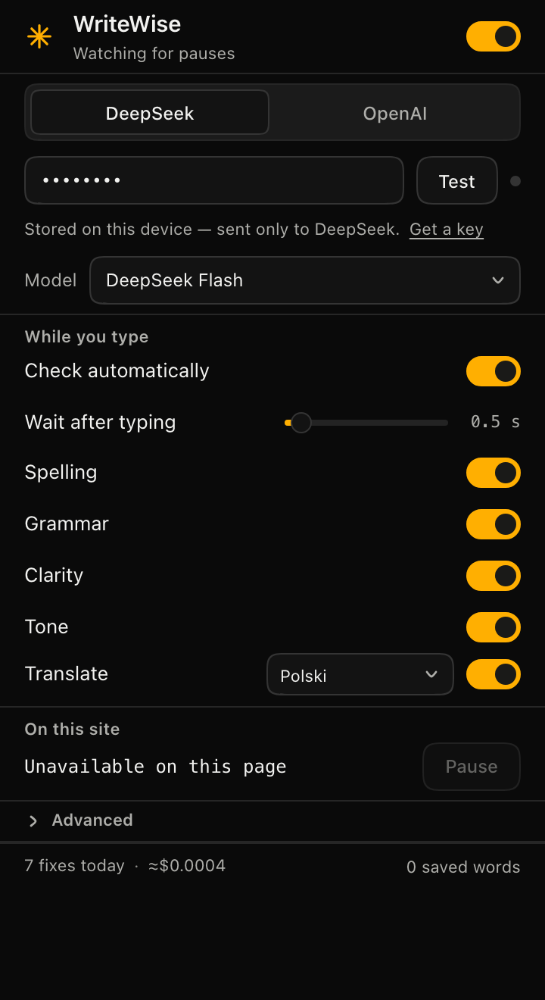
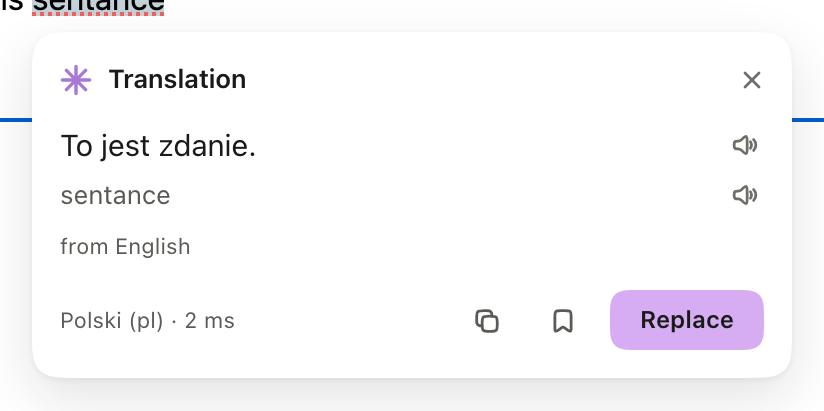
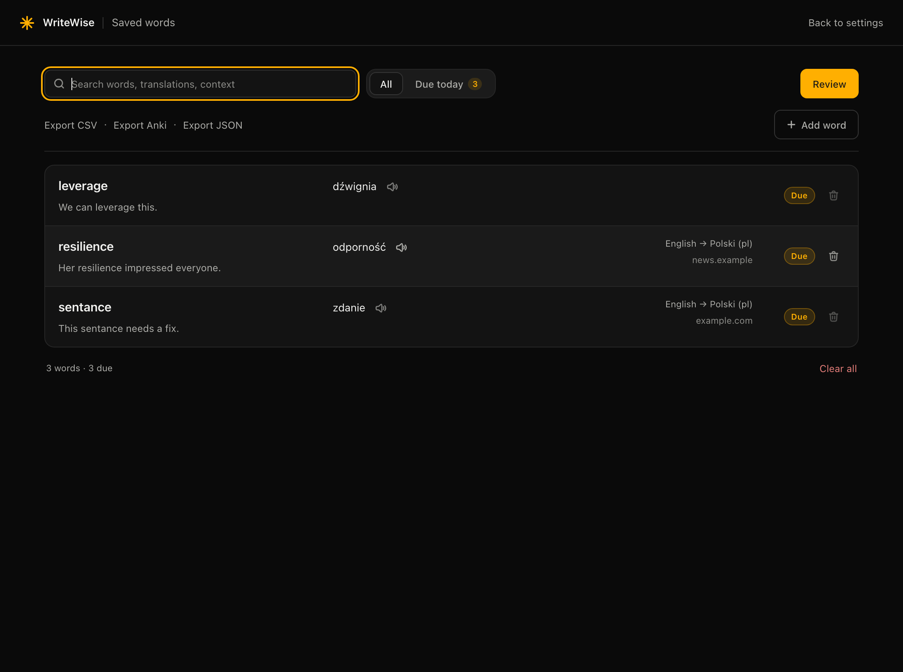

# WriteWise

A quiet proofreader for any text field on the web. It waits for you to pause,
shows what it would change, and applies it in one click — or one key. It also
translates — double-click a word or select a passage — keeps a local
vocabulary of the words you want to remember, and says them out loud.

Two providers, one key each: **DeepSeek** (default) or **OpenAI**.



## Install

1. Open `chrome://extensions`
2. Turn on **Developer mode**
3. **Load unpacked** → select this folder
4. Pin the ✳ icon to the toolbar

No build step, no `npm install`, no bundler. Edit a file, hit reload on
`chrome://extensions`.

## Setup

1. Click the ✳ icon
2. Pick **DeepSeek** or **OpenAI**
3. Paste a key and press **Test** — you get a green dot and the model list
   that key can actually see
4. Done. Keys are stored on this device only (`chrome.storage.local`).

Get a key: [platform.deepseek.com](https://platform.deepseek.com/api_keys) ·
[platform.openai.com](https://platform.openai.com/api-keys)

## How it works

- You type in any `input`, `textarea` or `contenteditable` field.
- After you stop for ~0.9 s, WriteWise sends the text to your provider and shows
  a card with an inline diff below the field.
- **Apply** replaces the text in place. To leave it alone, click anywhere outside
  the card, press `Esc`, or use the ✕.
  `Undo` after applying restores the original.
- The field's own undo stack still works: textareas and inputs get a native
  value write + `input` event, contenteditable gets `execCommand('insertText')`.

The card closes when you press `Esc`, click anywhere outside it, or hit its ✕.

Keyboard: `Enter` applies when the card is focused · `Esc` dismisses ·
`⌥⇧W` (Alt+Shift+W) checks the focused field on demand · right-click a text
selection → **Fix selection** checks only that fragment.

## Translate

- **Double-click a word** and it translates into your target language.
- **Select a passage** (up to ~240 characters) and it translates when you let go
  of the mouse.
- For anything longer, right-click → **Translate selection** (up to 2,400
  characters).
- The card shows the translation, the detected source language, and gives you
  **Copy** — or **Replace**, when the text came from a field you were editing.
- The **speaker** in the card's header plays the translation in the target
  language, so you can hear a word you have only ever read.



Pick the target language and switch translation on or off in the popup's
**Translate** row; turn off *Translate when I select text* under **Advanced** if
you only want double-click to translate.

## Saved words

When a translation is a single word, the card offers **Save** — it stores the
word, its translation, the sentence you found it in, and the site. Saving is
free: no API call, and nothing leaves the device.

Open the list from the popup footer (**N saved words**) for a full page with:

- search across words, translations and contexts;
- *All* / *Due today* filters and a live count;
- rows that expand to show the context, when it was added, review history and
  progress;
- **Review** — a spaced-repetition session over the due queue. Reveal with
  `Space`, grade with `1` (again) / `2` (good) / `3` (easy), `Esc` to leave.
  Intervals run 1 → 2 → 4 → 8 → 16 days;
- **Speakers** — the one next to a row plays the translation; in review, the
  word plays in its own language and the translation in the target language.
  `P` plays whichever side is showing;
- **Add word** for words you meet away from the browser;
- **Export CSV**, **Export Anki** (tab-separated, import straight into Anki) and
  **Export JSON**.



The vault holds up to 2,000 words in `chrome.storage.local`; saving the same
word again updates its translation instead of duplicating it.

## Pronunciation

Saved words and translations can be played out loud. This uses the speech
engine Chrome already has — the same voices you get from `say` on macOS or
Speech Dispatcher on Linux.

- **No key and no request.** Nothing is sent anywhere; no provider is billed.
- **Works offline**, using the voices installed on the device.
- One word at a time: starting a new one stops the previous one.
- Speaking rate is 0.95×, a touch slower than normal, because the point is to
  hear the word clearly.
- Quality depends on your system voices. If a language has no installed voice,
  Chrome pronounces it with its default voice instead of failing.

## Settings

| Setting | Meaning |
|---|---|
| Master switch | Pause everything |
| Provider + key + model | DeepSeek Flash / V4 Pro, GPT-6 Luna / 6.1 Terra / 5.4 nano |
| Check automatically | Off = only the shortcut and the context menu check |
| Wait after typing | 0.4 s – 3 s pause before a check |
| Spelling / Grammar / Clarity / Tone | What the model is allowed to touch |
| Tone preset | Professional, Casual, Formal, Friendly |
| Translate | Target language + on/off (double-click a word, or select text) |
| Saved words | Footer link to the vocabulary page, with a live count |
| On this site | Pause the current hostname |
| Advanced | Minimum characters, maximum words, tone presets, translate-on-select |

The popup also shows fixes today and an estimated spend.

## Privacy

- There is no WriteWise server. Text goes only to the provider you picked.
- Keys live in `chrome.storage.local` — not `storage.sync`, so they are not
  copied to your Google account.
- No telemetry, no analytics, no accounts.
- Password, payment (`autocomplete=cc-*`) and one-time-code fields are never
  read.
- Translation sends only the selected fragment, and only when you trigger it
  (double-click, or selecting text while that setting is on).
- Saved words never leave the device. The CSV/Anki/JSON exports are the only
  way out, and you run them yourself.

## Cost

A typical 500-word check is ~600 input + ~700 output tokens.

| Model | In / out per 1M | ≈ per check |
|---|---|---|
| `deepseek-flash` | $0.15–0.30 / $0.60–1.20 | ~$0.0005 |
| `gpt-6-luna` | $0.10 / $0.50 | ~$0.0004 |
| `gpt-6.1-terra` | $1.00 / $5.00 | ~$0.004 |

That is roughly **$0.40–0.50 per 1,000 checks** on the fast models.

## Limits

- Canvas editors (Google Docs, Figma) expose no editable DOM — out of scope.
- Fields inside iframes are not watched (content script runs in the top frame).
- Applying to a `contenteditable` replaces its content with plain text; the
  text is corrected, richer formatting inside it is not preserved.
- Very long fields are skipped above the word limit instead of being truncated.
- If a model answer is cut off (`finish_reason: length`) it is discarded rather
  than partially applied.
- Pronunciation is only as good as the voices installed on your system; there is
  no cloud text-to-speech in the product.

## Project layout

```
manifest.json          MV3, two API hosts, no broad host permissions
background.js          message router, API calls, stats, context menu
src/providers.js       one OpenAI-compatible client + error taxonomy
src/languages.js       translation targets + browser-language fallback
shared/speech.js       pronunciation through the browser's speech engine
icons/                 generated from icon.svg (16/48/128)
src/prompt.js          the guardrail prompt and JSON envelope
src/storage.js         settings/stats shape, defaults, v1 key cleanup
vocab/                 saved words: list, search, add, exports, review
src/vocab.js           word entries, Leitner schedule, export encoders
content/ui.js|css      in-page card (shadow DOM, seven states)
content/content.js     debounce, field adapters, apply/undo, guards
popup/                 settings surface (360 px, dark + light)
shared/tokens.css      design tokens — the only source of colour/type/space
PRODUCT.md, DESIGN.md  why it exists, how it should look
LICENSES.md            third-party notices (Hugeicons, MIT)
```

## Credits

Functional icons are [Hugeicons](https://hugeicons.com/icons/stroke-rounded),
stroke-rounded set, MIT — see [LICENSES.md](LICENSES.md). The ✳ mark is drawn
for WriteWise.

## Tests

```bash
# unit: provider client + settings (plain node, stubbed fetch/chrome)
node _wwtest/provider.test.mjs
node _wwtest/storage.test.mjs
node _wwtest/vocab.test.mjs
node _wwtest/speech.test.mjs

# end-to-end: real Chrome, real extension, mocked provider responses
_wwtest/run-all.sh
```

The e2e harness loads the unpacked extension in headless Chrome over CDP,
intercepts provider calls in the service worker, and drives the UI with real
mouse/keyboard events: auto-check debounce, request shape, apply/undo on all
three field types, error persistence, shadow-DOM isolation against hostile CSS,
per-site pause, word-limit guard, shortcut and selection paths.

## Differences from v2.7.0

- The translation card now shows the original alongside the translation, and
  each line has its own speaker: the original plays in the source language
  (`en`), the translation in the target (`pl`). The header no longer carries a
  lone speaker that could only mean one of them. The sentence `from English`
  stays under the original.

## Differences from v2.6.2

- The accent is orchid: `#d6adf2`. It is a light surface, so filled buttons,
  switch tracks and the toolbar icon carry an ink label at 9.2:1 — white would
  be 1.9:1. Where the accent is a graphic or text on white it steps down to
  `#a878d4` (3.3:1) and `#8448b0` (5.9:1); on the dark ground it stays `#d6adf2`
  (9.8:1). The ✳ mark rides that same graphic tone in each theme so it does not
  vanish on white. Full contract in `_wwtest/contrast.test.mjs`.

## Differences from v2.6.1

- The card's footer lost its hairline. Separation above it is a 14px gap; the
  card is now one uninterrupted surface from its top edge to its bottom, with
  the shadow as its only boundary.

## Differences from v2.6.0

- The card's footer has one labelled action. Copy and Save are now glyph
  buttons (a copy glyph and a bookmark, 30px discs, 13px icons) instead of light
  pills with dark text: the primary — Replace, Apply, Undo, Add key — is the
  only thing in the row with a word on it, and it stays the loudest object.
  Copy turns into a jade tick when it lands. Screen readers and the keyboard
  path are unchanged: each glyph button keeps `aria-label`, `title` and a
  visually hidden name.

## Differences from v2.5.2

- Shape: everything is rounder and more iOS. Glyph buttons are discs, actions
  are capsules (the card's Copy/Save/Replace/Apply, the popup's Test/Pause, the
  vocabulary page's buttons), fields sit at 14px, containers at 20px, and the
  card and review card at 24px. Corners are continuous where the engine can
  draw them (`corner-shape: squircle`, through the `--ww-corner` token) and
  degrade to a circular arc elsewhere.
- Cleaner: the card lost its hairline border — the shadow is the edge. The
  floating card is still the only depth in the product.

## Differences from v2.5.1

- Card rhythm: 14px padding, a 24px icon cluster in the header (13px speaker,
  12px close, 2px apart) instead of two loose glyphs, 12px from header to body,
  a 15px/1.45 translation, and the "from English" caption 4px under it. Same
  metrics in the prototype, so the two cannot drift.
- Replacements read as pairs: the inline `ins`/`del` chips now have 3px between
  them, so "Please pls" stops colliding into one word.
- The offline fallback stylesheet (used only if `tokens.css` cannot load) now
  carries the current neutral palette and the same metrics, so a broken CSS
  fetch degrades to the same card rather than the old cream one.

## Differences from v2.3

- Palette: the accent is now `#ffaf01`, and the neutrals are neutral rather than
  warm — the cream ground was doing more of the brand's talking than the accent.
  Accent *surfaces* — primary buttons, switch tracks, the toolbar icon — carry an
  ink label at 9.4:1 instead of white at 1.8:1, and accent *text* darkens to
  `#8f5c00` on the light ground. Every pair is asserted in
  `_wwtest/contrast.test.mjs`, so a palette tweak can't quietly fall below AA.
- Flatter UI: buttons are flat (no lift, no glow), switch knobs, segmented tiles
  and slider thumbs lost their small shadows. One depth remains, for the card.
- The popup, the in-page card and the toolbar icon are re-rendered in the new
  accent; the vocabulary page keeps its layout.

## Differences from v2.2

- Pronunciation: a speaker in the translation card, on saved-word rows, and in
  review, with `P` as the keyboard path. Browser speech engine — no key, no
  cost, offline.
- Saved words now remember the language pair as codes, so a word can always be
  played in the right language.

## Differences from v2.1

- Saved words: a local vocabulary with spaced repetition, search, and exports.
- Professional pass: regenerated icon set, warm focus rings, tighter type and
  spacing, vocabulary page with keyboard-first review.

## Differences from v1.1

- Translation added: double-click / select / right-click, with a target language.

## Differences from v1

- Claude / Gemini / Groq removed; DeepSeek + OpenAI only.
- Checks now actually run as you type (v1 only checked on a manual click).
- The "What to fix" switches work (v1's label handler cancelled its own toggle).
- In-page UI lives in a shadow root instead of global CSS.
- Errors persist instead of flashing for 200 ms.
- Keys moved out of cloud-synced storage; the v1 keys are deleted on upgrade.
